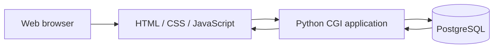
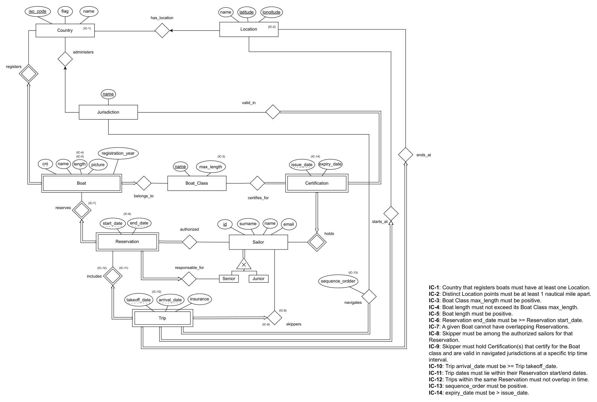

# Maritime Reservation System

[](#data-model)
[](#system-architecture)
[](#system-architecture)
[](#application-features)

**Relational database design and a three-tier web application for managing boats, sailors, reservations and sailing trips.**

Team project for Information Systems and Databases (SIBD), Instituto Superior Técnico, 2025/2026.

## Overview

The project spans two stages: conceptual and relational database modeling, followed by a Python web application backed by PostgreSQL. It models maritime operations, including vessel registrations, sailor certifications, navigated jurisdictions, reservation authorization and trip scheduling.

## System architecture



The presentation layer provides forms and tabular views. Python CGI scripts handle requests, validation, transactions and session checks. PostgreSQL stores the relational data and enforces database-level constraints.

## Data model

The conceptual model includes countries, locations, jurisdictions, boat classes, boats, sailors (senior and junior), reservations, trips and certifications. Relationships capture authorized sailors, responsible senior sailors, skippers, certification validity and the ordered jurisdictions navigated during a trip.

<p align="center">
  
</p>

*Conceptual data model from the team’s Part 1 report.*

[PDF version](./diagram.drawio.pdf) · [Editable diagram](./diagram.drawio)

Key business rules include valid dates, positive boat lengths, authorized skippers, non-overlapping bookings/trips and certification validity. The part-one schema implements primary and foreign keys, uniqueness and check constraints; some cross-table and temporal rules require additional triggers or application logic.

## Application features

| Module | Functionality described in the part-two report |
| --- | --- |
| Sailors | List, create and remove sailors; senior/junior classification |
| Reservations | List, create and remove bookings with date validation |
| Authorization | Manage which sailors may participate in each reservation |
| Trips | Manage voyages, departure/arrival locations and authorized skippers |
| Access control | Signed, expiring session cookies in the academic prototype |

The report also describes parameterized SQL, transactional inserts and deletes, client-side filtering, and server-side validation. The part-two implementation builds on a schema supplied by the teaching staff; it is not identical to the part-one schema.

## Repository organization

| File | Purpose |
| --- | --- |
| [schema.sql](schema.sql) | Part-one relational schema and constraints |
| [populate.sql](populate.sql) | Example data for exercising the schema |
| [queries.sql](queries.sql) | Four domain queries |
| [output.txt](output.txt) | Expected query results |
| [diagram.drawio](diagram.drawio) | Conceptual data model source |
| [IC_LEGEND.md](IC_LEGEND.md) | Integrity constraint notes |

The default branch documents part one. The web application was developed separately for part two and is not presented as a production-ready or directly deployable service. Its historical configuration needs a credential and security review before distribution or deployment.

## Run the database locally

Install PostgreSQL and use a new, disposable local database. The schema script drops existing tables, so never run it against a production or shared database.

```bash
createdb maritime_demo
psql -v ON_ERROR_STOP=1 -d maritime_demo -f schema.sql
psql -v ON_ERROR_STOP=1 -d maritime_demo -f populate.sql
psql -v ON_ERROR_STOP=1 -d maritime_demo -f queries.sql
```

Compare the returned results with `output.txt`. The web application requires a compatible Python CGI environment, psycopg2, the part-two schema and securely configured local connection settings. Do not reuse historical secrets or database credentials.

## Contributors

Team project (Group 4): Luís Almeida, Dinis Silva and Ana Cláudia Vilela.

Instituto Superior Técnico · University of Lisbon · 2025/2026.
