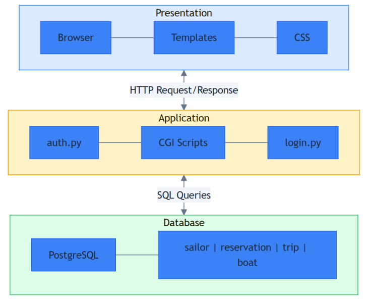
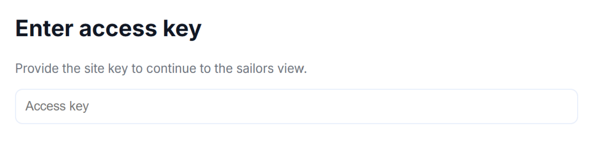
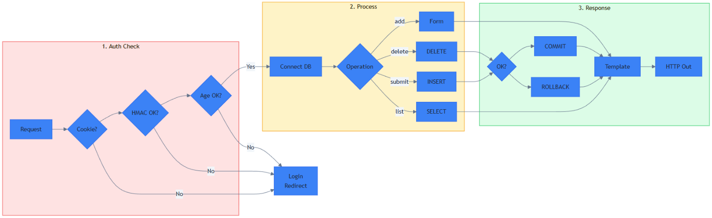

# Maritime Reservation & Management System

[](#part-2--web-application)
[](#part-1--database-engineering)
[](#web-interface)
[](#application-features)

**A full-stack maritime management prototype, combining relational database engineering with a web application for managing sailors, boat reservations, authorizations and sailing trips.**

Developed as a three-person team project for Information Systems and Databases (SIBD), Instituto Superior Técnico, University of Lisbon — 2025/2026.

## Overview

The project was developed in two stages:

| Part 1 — Database engineering | Part 2 — Web application |
| --- | --- |
| Conceptual entity–relationship model | Three-tier web architecture |
| Relational schema and integrity constraints | Python CGI backend and PostgreSQL |
| SQL queries and representative test data | HTML/CSS interface and dynamic JavaScript forms |
| Maritime business-rule modeling | Authentication, validation and transactional operations |

Part 2 extended the database engineering work into an interactive website, originally hosted on Técnico's institutional web infrastructure. Current deployment availability has not been verified. The historical application requires a credential and security review before a public demo is promoted.

<!-- Add the verified live demo URL here after rotating historical credentials and reviewing the deployment. -->

## Part 2 — Web application

The application implements a three-tier architecture that separates presentation, application logic and data management. The backend uses Python CGI scripts and psycopg2 to communicate with PostgreSQL; HTML templates, CSS and JavaScript provide the browser interface.

### System architecture

<p align="center">
  
</p>

*Three-tier application architecture from the Part 2 project report (Figure 1).*

| Layer | Responsibilities |
| --- | --- |
| Presentation | Responsive templates, forms, tabular views, dynamic selection controls |
| Application | Request handling, session verification, business rules, input validation, parameterized SQL and transaction management |
| Database | Relational storage, referential integrity and database-level constraints |

### Application features

| Module | Implemented functionality described in the report |
| --- | --- |
| Sailor management | List, register and delete sailors; senior/junior specialization; transactional insertion and dependency-aware deletion |
| Boat reservations | Display bookings grouped by boat; create and delete reservations; validate dates and responsible senior sailors |
| Authorization management | Grant and revoke sailor participation in reservations; handle duplicate records and transaction rollback |
| Trip management | List and create voyage records; select departure and destination, reservation, skipper and insurance; validate reservation dates and skipper authorization |
| Authentication | Shared access-key prototype with signed, time-limited session cookies and protected routes |

The trip form dynamically filters available skippers in JavaScript according to the selected reservation. Server-side validation remains authoritative, and database constraints provide an additional integrity layer.

### Web interface

<p align="center">
  
</p>

*Original login interface, captured in the Part 2 report (Figure 2). The report does not include screenshots of the remaining management pages.*

### Authentication and data integrity

The academic prototype uses HMAC-SHA256-signed, timestamped session tokens stored in HttpOnly cookies, with a one-hour validity period. Shared backend utilities check sessions before processing protected requests. The report also describes parameterized SQL, explicit commit/rollback handling and HTML escaping.

These mechanisms illustrate application security and data-integrity concepts; this is not a security-audited production authentication system. Historical access keys and database credentials must be removed or rotated before reuse. No credentials are included in this documentation.

### Request processing

<p align="center">
  
</p>

*Request execution flow from the Part 2 report (Figure 3).*

Each request passes through authentication, operation selection, database interaction and template rendering. The CGI process exits after returning the response. The report discusses moving to a persistent WSGI server for larger deployments to reduce process startup overhead, and adding indexes to frequently queried foreign keys as data volumes grow. These are proposed improvements, not features claimed as implemented.

## Part 1 — Database engineering

### Entity–relationship model

<p align="center">
  
</p>

*Original conceptual data model from the Part 1 project submission.*

[PDF diagram](./diagram.drawio.pdf) · [Editable Draw.io diagram](./diagram.drawio)

The model captures boats, countries, jurisdictions, locations, boat classes, sailors, certifications, reservations and trips. Relationships represent reservation responsibility, authorized sailors, skipper assignments, certification validity and ordered jurisdictions navigated during a trip.

The Part 1 SQL schema implements primary keys, foreign keys, uniqueness and check constraints. More complex temporal and cross-table rules require additional enforcement. Part 2 uses a different schema supplied by the teaching staff, populated by the team and extended with application logic and integrity checks; the two schemas are not interchangeable.

### SQL queries

The project includes representative queries for identifying boats used or not used in trips, Portuguese boats with responsible sailors matching specified criteria, and skippers lacking applicable certifications. The included test data and expected outputs support verification of the database design.

## Repository structure

| Branch | Contents |
| --- | --- |
| `main` | Part 1 — conceptual model, SQL schema, sample data and queries |
| `part2` | Part 2 — Python CGI web application, templates, CSS, revised schema, integrity constraints and SQL views |

The `main` branch contains:

```text
schema.sql       # Part 1 schema and integrity constraints
populate.sql     # Sample data
queries.sql      # Domain queries
output.txt       # Expected outputs
diagram.drawio   # Editable conceptual model
IC_LEGEND.md     # Integrity constraint notes
docs/            # Diagrams and interface images
```

The `part2` branch contains `application/cgi-bin/`, `application/templates/`, `application/static/`, `application/index.html`, and the corresponding SQL files. The report documents the final deployed architecture; the historical branch may not contain every deployed module or dependency. Review configuration and remove exposed credentials before using or promoting it.

## Getting started

### Part 1 — local database

Install PostgreSQL and use a disposable local database. The schema contains DROP TABLE statements: do not run it against a shared or production database.

```bash
createdb maritime_demo
psql -v ON_ERROR_STOP=1 -d maritime_demo -f schema.sql
psql -v ON_ERROR_STOP=1 -d maritime_demo -f populate.sql
psql -v ON_ERROR_STOP=1 -d maritime_demo -f queries.sql
```

Compare the query output with `output.txt`.

### Part 2 — web application

The historical implementation requires a Python environment compatible with CGI, psycopg2, a CGI-enabled web server, the Part 2 PostgreSQL schema and newly configured local credentials. The original deployment depended on university infrastructure; a reproducible local deployment has not been verified.

## Contributors

Luís Almeida · Dinis Silva · Ana Cláudia Vilela

Team project (Group 4) — Information Systems and Databases, Instituto Superior Técnico, 2025/2026.
